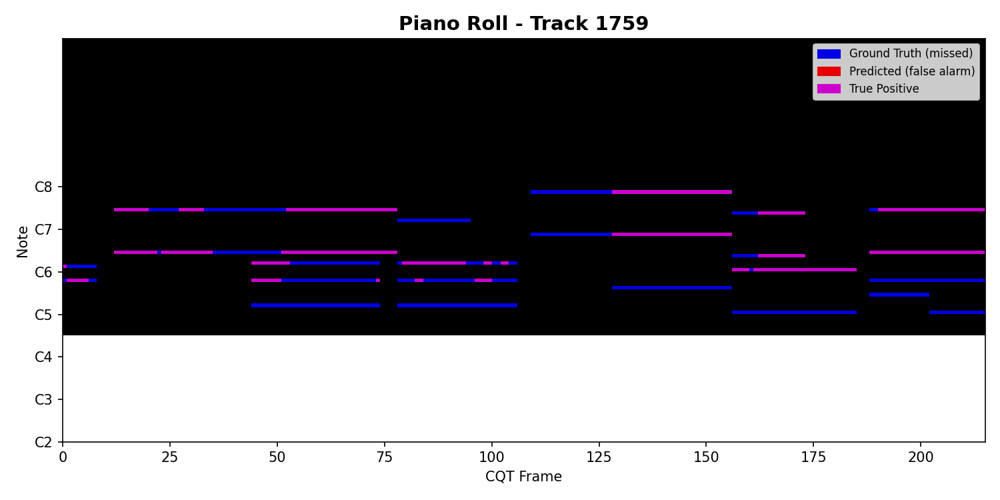
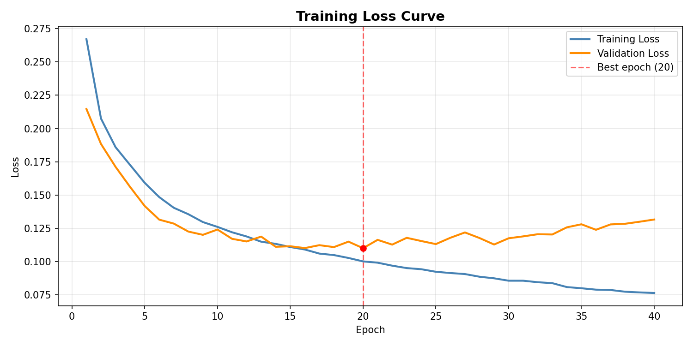
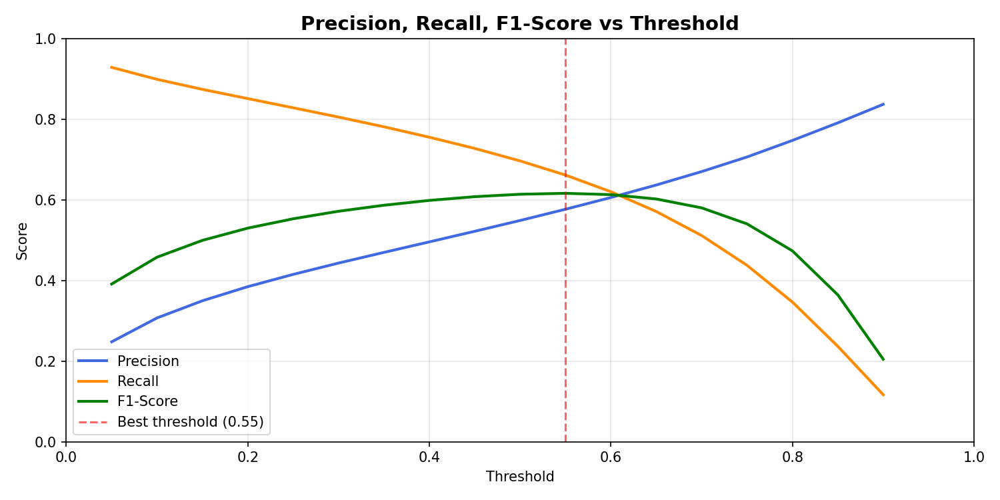
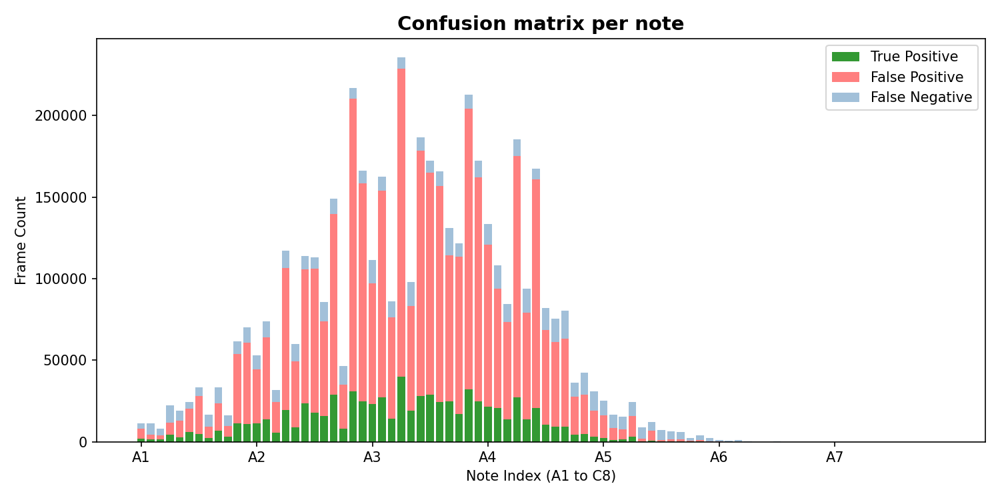
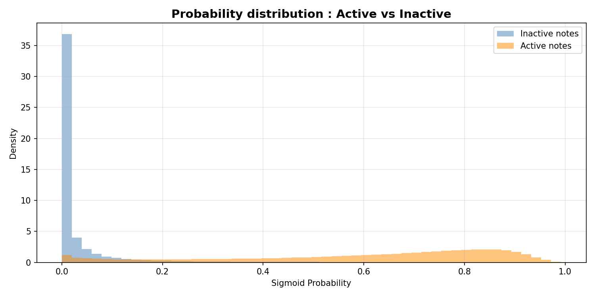

# Automatic Piano Transcription with a CRNN

A deep learning pipeline that turns **solo piano recordings into a piano roll** (which notes are active in each time frame). From that piano roll a symbolic, MIDI-like transcription can be built. The model is a **Convolutional Recurrent Neural Network** (CNN + bidirectional LSTM) trained on **Constant-Q Transform** spectrograms from the MusicNet dataset.

> Group project for the course *Machine Learning for Vision and Multimedia*, Politecnico di Torino.

<p align="center">
  
</p>

---

## Highlights

- **End-to-end pipeline**: dataset download → filtering → preprocessing → training → evaluation → plots, all run from a single CLI.
- **Music-aware features**: an 84-bin **CQT** (7 octaves, 12 bins per octave), so each frequency bin lines up with a piano semitone.
- **CRNN architecture**: 2D convolutions learn local time-frequency patterns (harmonics, onsets), and a **BiLSTM** models how long notes last over time.
- **Class imbalance handling**: weighted BCE loss (`pos_weight`) because active notes are rare (about 2.5% of labels), plus decision-threshold tuning on the precision/recall curve.
- **Reproducible experiments**: every hyperparameter lives in a YAML config, and every run is logged with a timestamp (`logs/`).

## Approach

| Stage | Details |
|---|---|
| **Data** | [MusicNet](https://zenodo.org/records/5120004) (via KaggleHub), filtered to *Solo Piano* recordings only |
| **Input** | 7 s audio chunks @ 22.05 kHz → CQT magnitude in dB, 84 bins, hop 512 |
| **Labels** | Frame-level multi-hot piano roll (84 pitches) aligned with the CQT frames |
| **Model** | 2 × [Conv2D → BatchNorm → ReLU → MaxPool] → BiLSTM (2 layers, 256 hidden) → Linear (84) |
| **Training** | Adam, BCEWithLogits with positive-class weighting, ReduceLROnPlateau scheduler, best-checkpoint saving |
| **Evaluation** | Frame-level precision / recall / F1, per-note confusion, probability distribution analysis |

## Results

| Training loss | Precision / Recall vs threshold |
|---|---|
|  |  |

| Per-note confusion | Output probability distribution |
|---|---|
|  |  |

More piano roll comparisons are in [`plots/`](plots/), and the full training logs from the hyperparameter search are in [`logs/`](logs/).

## Tech stack

**Python** · **PyTorch** · torchaudio · librosa · NumPy · pandas · TensorBoard · PyYAML

## Project structure

```text
audio-music-transcript/
├── main.py                 # CLI entry point
├── configs/config.yaml     # Dataset, model, training & evaluation settings
├── scripts/
│   ├── download_and_filter.py  # Downloads MusicNet, builds solo_piano.csv
│   └── build_dataset.py        # Copies the solo-piano files into data/raw/
├── src/
│   ├── dataset.py          # PyTorch Dataset: chunking, CQT, label alignment
│   ├── model.py            # CRNN (CNN + BiLSTM)
│   ├── train.py            # Training loop, scheduler, checkpointing
│   ├── evaluate.py         # Metrics
│   ├── plots.py            # Training/evaluation plots
│   ├── report.py           # Run logging
│   └── utils.py            # CQT extraction, seeding, config & checkpoint helpers
├── logs/                   # Logs of each experiment
└── plots/                  # Generated figures
```

## Getting started

```bash
pip install -r requirements.txt

python main.py --download   # 1. download MusicNet and filter the solo-piano tracks
python main.py --build      # 2. build the local dataset in data/raw/
python main.py --train      # 3. train the model (settings in configs/config.yaml)
python main.py --evaluate   # 4. evaluate and generate plots
```

> On Windows, use `py main.py ...` if `python` isn't on your PATH.
